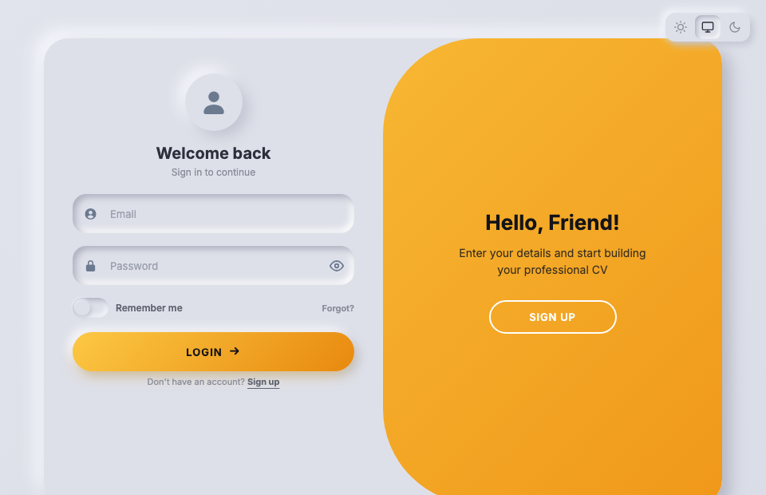
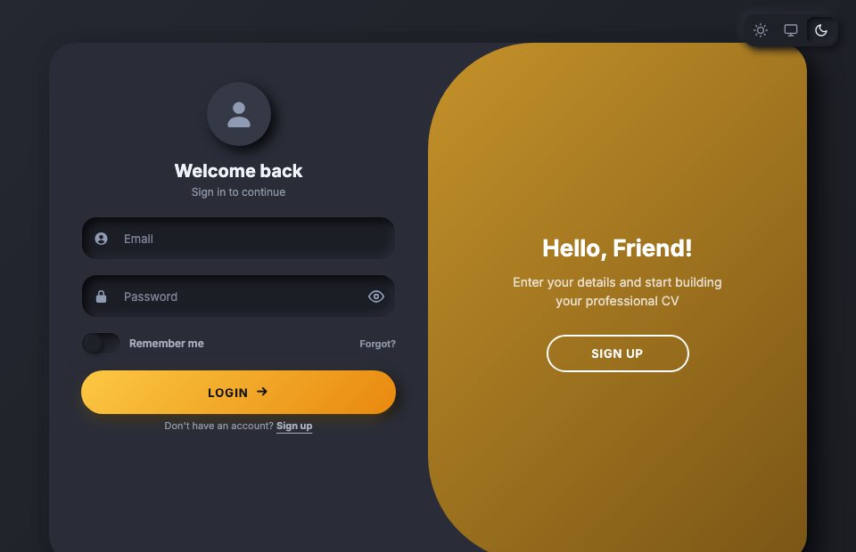
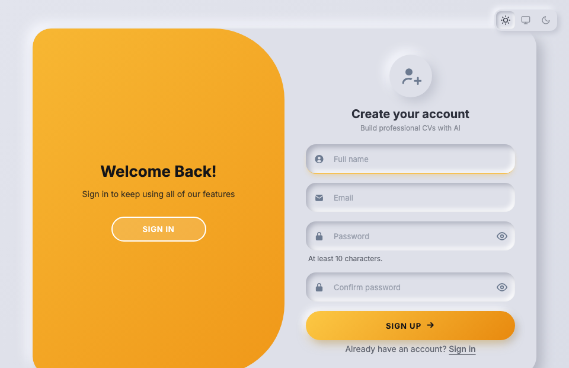

# Neumorphic Sliding Login

A premium neumorphic (soft UI) dual-panel login/register page with a sliding amber overlay, dark mode, and smooth CSS animations. Single `index.html` — no framework, no build step.



## Demo Video

https://github.com/user-attachments/assets/bbfc8667-3cc7-4e85-b4a8-b334f908005f

## Features

- **Dual-panel layout** — Login on the left, Register on the right (850px card)
- **Sliding amber overlay** with a curved inner edge (120px border-radius) that slides between panels
- **Dark mode** with a muted dark-gold overlay, lifted card surface, and hand-tuned shadows
- **3-way theme toggle** — Light / System / Dark (persisted in localStorage, no flash on load)
- **Neumorphic controls** — inset fields, raised badge, soft switch, gradient CTA button with glow
- **Password visibility toggle** (eye/eye-off)
- **Responsive** — single 420px card with a toggle bar on mobile (< 768px)
- **Accessible** — screen-reader labels, `aria-live` announcements, keyboard navigation, focus glow
- **`prefers-reduced-motion`** respected — all animations disabled
- **Autofill styled** — browser autofill doesn't break the neumorphic look

## Screenshots

| Light Mode | Dark Mode |
|---|---|
|  |  |

| Register Panel |
|---|
|  |

## Quick Start

```bash
git clone https://github.com/umeshkpandit/neumorphic-sliding-login.git
cd neumorphic-sliding-login
open index.html
```

No dependencies. No build. Just open in a browser.

## Tech Stack

| | |
|---|---|
| **HTML** | Semantic, accessible markup |
| **CSS** | Custom properties, neumorphic shadows, CSS transitions, `cubic-bezier` timing |
| **JavaScript** | Vanilla JS — panel switching, theme toggle, password visibility |
| **Font** | [Inter](https://fonts.google.com/specimen/Inter) (Google Fonts) |

## Design Details

### Neumorphic Shadows

```css
/* Raised card */
box-shadow: 10px 10px 20px #b4b7c3, -10px -10px 20px #f6f7fd;

/* Inset field */
box-shadow: inset 4px 4px 8px #adb0be, inset -4px -4px 8px #ffffff;

/* Focus glow */
box-shadow: inset 5px 5px 9px #adb0be, inset -4px -4px 8px #ffffff,
            0 6px 10px -4px rgb(247 183 51 / 0.45), 0 2px 0 -1px #f7b733;
```

### Dark Mode Strategy

The dark mode isn't a simple color inversion:

- **Card** lifts to `#2a2d38` (lighter than the page background) so fields appear properly inset
- **Fields** sink to `#1c1e26` with a subtle `rgba(255,255,255,0.08)` border
- **Badge** pops at `#353845`
- **Overlay** shifts from bright amber to a **muted dark-gold** gradient (`#c4922a → #7a5515`) with white text
- **Shadows** are asymmetric — deeper on the dark side, softer on the light

### Sliding Animation

```css
transition: transform 0.6s cubic-bezier(0.65, 0, 0.35, 1),
            border-radius 0.6s cubic-bezier(0.65, 0, 0.35, 1);
```

The overlay border-radius animates with the slide — `120px 31px 31px 120px` flips to `31px 120px 120px 31px` — creating a smooth curved-edge effect.

### Color Tokens

| Token | Light | Dark |
|---|---|---|
| Surface | `#dee0e9` | `#1f2128` |
| Card shadow (dark side) | `#b4b7c3` | `#0d0e12` |
| Card shadow (light side) | `#f6f7fd` | `rgba(43,46,56,0.25)` |
| Inset dark | `#adb0be` | `#0b0c10` |
| Inset light | `#ffffff` | `#2b2e38` |
| Title | `#2d303c` | `#f1f3f8` |
| Text | `#383c47` | `#e6e9f0` |
| Icon | `#6c7a90` | `#8f9bb3` |
| Accent | `#f7b733` | `#f7b733` |

## File Structure

```
neumorphic-sliding-login/
├── index.html              # The complete demo (HTML + CSS + JS)
├── sliding-animation.mp4   # Demo video for social media
├── preview-light.png       # Light mode screenshot
├── preview-dark.png        # Dark mode screenshot
├── preview-register.png    # Register panel screenshot
└── README.md
```

## Browser Support

Tested in Chrome, Safari, Firefox, and Edge. Uses standard CSS custom properties, flexbox, and transitions — no vendor prefixes needed for modern browsers.

## License

MIT

## Author

**Umesh Kumar Pandit**
Magento, Hyva, Next.js, Mobile App & AI Agentic Developer

- GitHub: [@umeshkpandit](https://github.com/umeshkpandit)
- LinkedIn: [Connect with me](https://www.linkedin.com/in/umeshkpandit/)
